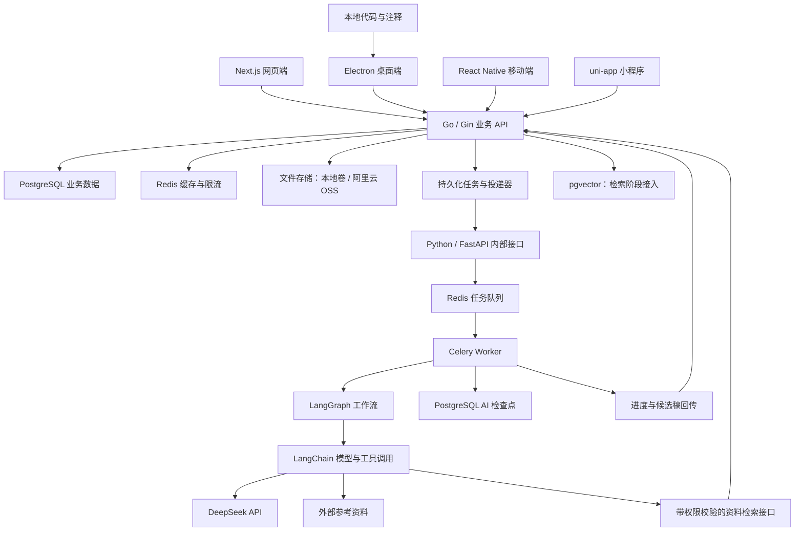
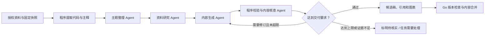

# 多端 AI 代码笔记与知识管理平台

需求基线确认日期：2026-10-09。

这是新项目的设计资料，保存在当前 Go 学习目录下的独立位置。尚未创建产品代码、安装依赖或部署服务。后续建立产品仓库时，将本目录的内容迁入产品仓库的文档目录。

- [实施设计、数据模型、API 与里程碑](IMPLEMENTATION.md)
- [领域术语表](CONTEXT.md)

## 1. 项目目标

以一个真实业务完整串联 Go、Gin、Python、LangChain、LangGraph、Next.js、uni-app、Electron、React Native 和 Docker，并深入学习 AI 工程。

核心业务：把代码文件中的零散注释和学习记录，整理为按主题组织、带原始代码引用、外部资料依据和图解的知识文档。

交付范围包含全部四类客户端、业务后端、AI 服务和部署运维。开发阶段表示实施顺序，最终验收覆盖所有端。最初由自己使用，同时具备多用户及授权协作能力。

## 2. 已确认的需求

| 项目 | 确认内容 |
| --- | --- |
| 原始资料 | 主要在代码文件中记录笔记，注释与对应代码一起理解 |
| 整理单位 | 以知识主题组织，可以关联多个来源文件 |
| 输出 | 独立 Markdown 文档，包含可编辑的 Mermaid 图表 |
| 内容深度 | 解释概念、用途、使用场景，补齐理解所需的前置知识 |
| 外部资料 | 允许 AI 查阅官方文档等资料，标明来源与适用版本 |
| 自动更新 | 源代码或注释变化后，自动更新受影响主题 |
| 人工编辑 | 用户可以直接修改生成的文档 |
| 冲突处理 | 无冲突内容自动合并；冲突保留当前内容，提供依据并等待处理 |
| 用户体系 | 多用户注册，每个用户拥有独立知识空间，同账号跨端同步 |
| 协作 | 多人获得编辑权限、分别修改保存；本期不做实时共同输入和共同光标 |
| 编辑器 | 富文本与 Markdown 源码可切换 |
| 模型 | 首版主要使用 DeepSeek 云端 API |
| 向量模型 | 接受另接向量模型 API；厂商、型号、维度、费用到检索阶段再确定 |
| 业务后端 | Go + Gin |
| AI 层 | Python + LangChain + LangGraph |
| 客户端 | Next.js 网页、Electron 桌面、React Native 移动、uni-app 小程序 |
| 部署 | 本地开发，后续部署到阿里云，Docker 管理运行环境 |

其余技术实现是本设计的建议默认值，可在实现时依据测试结果调整，不需要重新讨论已经确认的业务范围。

## 3. 一次完整的使用过程

1. 注册并进入个人知识空间，创建“Go 学习”等知识项目。
2. 在 Electron 中选择来源目录，确认纳入同步的文件；网页与移动端也可导入文件。
3. 系统保存来源快照，提取注释及相邻代码，建立主题关联。
4. AI 结合原资料和外部证据，生成主题大纲、解释、代码讲解及适合的图表。
5. 用户在任一端阅读、问答和编辑，以独立 Markdown 形式导出成果。
6. 拥有者授权其他用户阅读或编辑指定成果。
7. 来源变化后，系统自动重新整理受影响内容，保留人工编辑和历史版本。
8. 出现冲突时，无冲突区块可以继续更新，冲突区块保持当前内容并显示待处理状态。

主题首次整理时可先展示 AI 提出的目录并允许调整。后续自动更新沿用已有主题边界，跨入新主题的内容可以形成归类建议，避免每次保存代码都打乱目录。

## 4. 系统架构

逻辑上的 PostgreSQL 业务数据、检索向量和 AI 检查点，初期可以位于同一实例，通过独立 schema 和数据库账号限制访问。Redis 初期可以共用实例，但任务队列与普通缓存使用不同命名空间和明确的持久化、过期策略。

Go 是业务状态的管理方：身份、授权、资料可见范围、文档发布、版本合并和任务状态都由 Go 决定。Python 负责 AI 执行过程，回传候选结果，不直接改写已发布的业务文档。

Next.js 负责网页体验；它需要的服务端渲染能力不另建一套平行的业务规则。所有端使用同一套业务 API 和权限约定。

## 5. 技术组成及选型理由

| 技术 | 作用 | 学习重点 |
| --- | --- | --- |
| Go + Gin | 模块化业务 API | HTTP、错误处理、事务、并发、权限、测试 |
| PostgreSQL | 业务与版本数据的持久化 | 关系建模、索引、事务、约束、迁移 |
| pgx / pgxpool | Go 访问 PostgreSQL 的建议方案 | 参数化 SQL、连接池、事务与查询排查 |
| Python + FastAPI | AI 任务接口 | 类型约束、接口验证、异步 I/O、服务边界 |
| LangChain | 模型适配、检索与工具调用 | 工具定义、结构化输出、上下文组织 |
| LangGraph | AI 工作流 | 显式状态、分支、检查点、恢复与终止条件 |
| Celery + Redis | 长任务执行 | 重试、幂等、并发上限、取消和故障恢复 |
| DeepSeek API | 生成、解释与推理 | 提示词、Token 成本、流式输出、限流处理 |
| pgvector | 语义检索 | 向量索引、过滤、召回与评测 |
| JWT + 可撤销会话 | 访问凭证与续期 | 过期、轮换、多端会话、退出失效 |
| Markdown + Mermaid | 文档与图表 | 解析、渲染、编辑往返、版本比较 |
| Docker Compose | 本地与初期部署编排 | 镜像、网络、卷、健康检查、环境配置 |
| 反向代理 + HTTPS | 对外入口 | 域名、TLS、代理超时和流式响应 |
| 阿里云 ECS + OSS | 线上计算与对象存储 | 发布、访问控制、备份、恢复 |

具体依赖版本在工程初始化时核实并锁定。向量服务与聊天模型分开选型，当前不预设向量维度，不据此生成数据库迁移。

## 6. 四端功能边界与完成标准

| 能力 | 网页 Next.js | 桌面 Electron | 移动 React Native | 小程序 uni-app |
| --- | --- | --- | --- | --- |
| 注册登录、个人空间 | 完整支持 | 完整支持 | 完整支持 | 完整支持，平台账号绑定在接入阶段落地 |
| 项目、主题与文档管理 | 完整支持 | 完整支持 | 移动交互适配 | 小程序交互适配 |
| 富文本 / Markdown 编辑 | 完整支持 | 完整支持 | 编辑界面适配 | 编辑界面适配 |
| 代码、图片、表格、图解 | 编辑与预览 | 编辑与预览 | 编辑与预览 | 编辑与预览 |
| AI 问答与任务状态 | 流式展示、进度与取消 | 同网页能力 | 按平台能力适配 | 按平台能力适配 |
| 分享、授权、版本和冲突 | 完整支持 | 完整支持 | 适配小屏幕 | 适配小屏幕 |
| 来源导入 | 上传文件或目录清单 | 本地目录绑定、文件监听 | 系统文件选择与导入 | 平台文件选择与导入 |
| 原代码定位 | 代码快照及行号 | 本地编辑器定位和快照 | 代码片段查看 | 代码片段查看 |
| 离线能力 | 保存未提交草稿 | 草稿、缓存和同步队列 | 离线阅读、草稿和恢复同步 | 按平台存储能力缓存草稿 |
| 导出成果 | 下载 Markdown 及资源 | 写入用户选择的输出目录 | 下载或系统分享 | 平台允许的下载或分享方式 |

“完整支持”指相同的业务能力与权限规则，不要求四套 UI 使用同一个渲染组件。Vue 的 uni-app 与 React 客户端共享接口契约、内容约定和适用的纯逻辑，不强行复用框架组件。

离线草稿携带原文档版本。恢复网络后按版本检查提交，旧草稿不能直接覆盖新修订。AI 整理和外部资料查询需要连接服务端。

编辑器建议先验证 Web/Electron 的 Markdown 编辑组件。React Native 可用受控 WebView 复用编辑界面；小程序按原生能力组织富文本与源码区块。原生富文本不支持的 Markdown 结构必须保留为可编辑源码区块并提供预览，不能静默丢失。

## 7. Markdown 与富文本的一致性

Markdown 是知识文档的权威内容格式。编辑器内部可以使用结构化状态，但不让各端形成彼此无法还原的独立格式。

共同约定支持标题、段落、列表、引用、链接、图片、表格、围栏代码块、Mermaid 代码块及引用标记。代码块内容、语言标记和图表源码需要精确保留；其他等价排版可以规范化。

编辑器原型必须通过以下往返检查：

1. Markdown 导入富文本，保存后再次打开，内容和结构一致。
2. 包含中文、嵌套列表、表格、代码和 Mermaid 的组合文档不丢内容。
3. 未识别的语法保留原文，并提供源码编辑入口。
4. 各端导出同一文档，代码片段、引用和图表源码一致。
5. HTML 和图表渲染采用受限策略，文档内容不能执行任意脚本。

Electron 同时支持把主题文档同步为独立的本地 .md 文件，并同步用户在外部编辑器中作出的修改。成果目录与来源目录分别管理，双向文档同步采用版本检查，保留未提交的本地改动。

导出为独立 .md 文档时保留代码片段、来源路径与快照标识、外部链接和 Mermaid 源码。需要本地图片时一起导出资源目录，避免导出结果依赖即将过期的签名链接。

## 8. AI 工作流与多 Agent

| 职责 | 产出 | 主要约束 |
| --- | --- | --- |
| 主题整理 Agent | 主题关联、大纲、重复内容和知识缺口 | 使用授权资料；保留已有主题和人工组织 |
| 资料研究 Agent | 证据摘要、URL、版本、抓取时间、支持的结论 | 优先官方资料；资料内容不能变成新的执行指令 |
| 内容生成 Agent | 讲解、原始代码引用、Mermaid 源码、引用关系 | 区分原笔记与补充内容；不把推测写成确定事实 |
| 内容核查 Agent | 证据缺口、矛盾及修订建议 | 核查是辅助判断，仍需评测和明确的结构校验 |

固定步骤由代码执行：权限判断、大小限制、文件哈希、引用定位、输出结构校验、Mermaid 语法检查、版本保存。多个 Agent 可以使用同一个 DeepSeek 模型，以职责、上下文和工具权限区分。

工作流的状态至少记录任务标识、来源快照、文档基线、证据列表、草稿、修订次数、调用用量和检查点。设置最大步骤、最长耗时、调用次数与费用预算，避免无界循环。

首次实现先跑通可测试的单条生成链，再加入分工与核查。最终项目保留单链与多 Agent 的评测对照，验证协作是否改善结果。

知识问答复用同一套授权检索和引用机制。回答产生的内容只有经用户保存或明确的整理流程，才成为文档修订。

## 9. 自动更新与人工修改

1. 来源变化先合并连续保存事件，只处理内容哈希发生变化的文件。
2. 通过主题与来源关系定位受影响的主题，生成任务绑定固定快照和基线。
3. 对照“上一次 AI 生成基线、当前人工编辑稿、新候选稿”，按内容区块生成更新。
4. 无冲突区块自动合并，冲突区块保留当前内容及待处理标记。
5. 保存前再次检查文档版本；发现并发保存时重新比较，不能直接覆盖。
6. 每次成功更新创建新修订。撤回历史内容也形成新修订，保留审计关系。

冲突尚未解决时，不把存在歧义的区块直接提升为新生成基线；保留该区块的旧基线、当前内容、候选内容及来源。后续重复任务更新同一待处理冲突，避免把人工修改错误地当成已采纳的 AI 内容。

文字、代码展示、图表和引用都参与比较。合并工具无法可靠判断含义时，保守进入冲突处理。AI 可以解释差异，但不能自行决定覆盖人工内容。

## 10. 权限与数据边界

默认每位用户拥有独立空间。建议按项目、主题和文档授予阅读或编辑权限；拥有者负责授权，编辑者可以编辑获授权内容，阅读者只能查看。

文档分享会让文档正文及其中已经包含的代码片段对协作者可见。只分享文档不代表分享整个来源目录。跳转原始文件、下载完整代码、检索其他资料需要对应权限。

AI 检索、缓存、任务回调和导出同样执行权限检查。向量检索先限定可见资料范围，不能先检索全库再把其他用户的内容发给模型。

后台任务的执行身份、可用资料范围和最终输出位置必须可追溯。共享文档自动生成使用明确绑定的资料集合，扩大资料范围需要拥有者授权。

## 11. 评测与质量目标

建立一批自己熟悉、可人工核对的代码笔记样本，覆盖 Go、Python、JavaScript / TypeScript，以及跨文件关联、错误注释、资料缺失和版本差异。

| 维度 | 检查内容 |
| --- | --- |
| 提取质量 | 注释是否关联正确函数和代码位置，切分是否丢上下文 |
| 检索质量 | 已知问题能否找到正确片段，权限过滤是否正确 |
| 内容质量 | 解释是否符合代码，补充内容有无可靠依据 |
| 引用质量 | 引用是否能定位，证据是否支持相应结论 |
| 图表质量 | 语法是否可渲染，流程是否与代码及说明一致 |
| 更新质量 | 人工修改是否保留，冲突是否明确，过期任务是否被阻止 |
| 工程成本 | 耗时、模型调用次数、Token、失败率与重试次数 |

同时保存单链和多 Agent 的结果，以相同输入比较。模型返回自评高分不能替代事实核对；引用存在也不代表引用一定支持结论。

确定性的权限、结构和版本检查纳入自动化测试。事实性样本结合人工评审，记录改进结果，不承诺模型永远正确。

## 12. 后续待定项

- 向量模型服务商、型号、维度、价格和重排方案：到检索实现阶段确认。
- DeepSeek 具体模型与调用参数：根据当时官方文档和评测锁定。
- 外部资料搜索与抓取渠道：在资料研究模块接入时确认。
- 四端编辑器具体依赖与版本：以往返保真原型为依据选择。
- 小程序目标平台、移动和桌面的发行平台、签名账号：在客户端初始化与发布准备时确定。
- 阿里云实例规格、域名及费用预算：根据压测和使用量确定。

这些待定项不改变已经确认的完整业务范围。第一步实施内容见 [IMPLEMENTATION.md](IMPLEMENTATION.md)。
